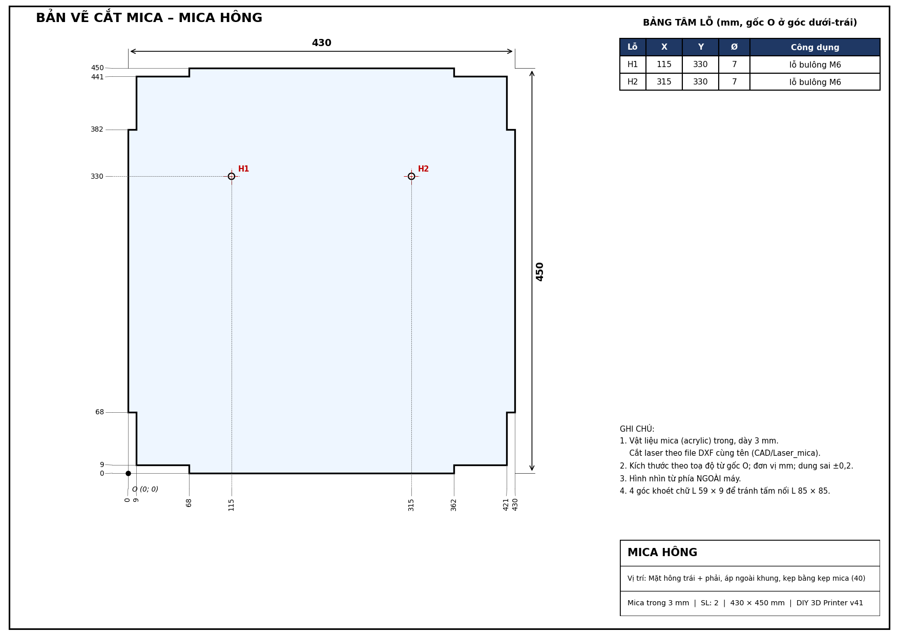
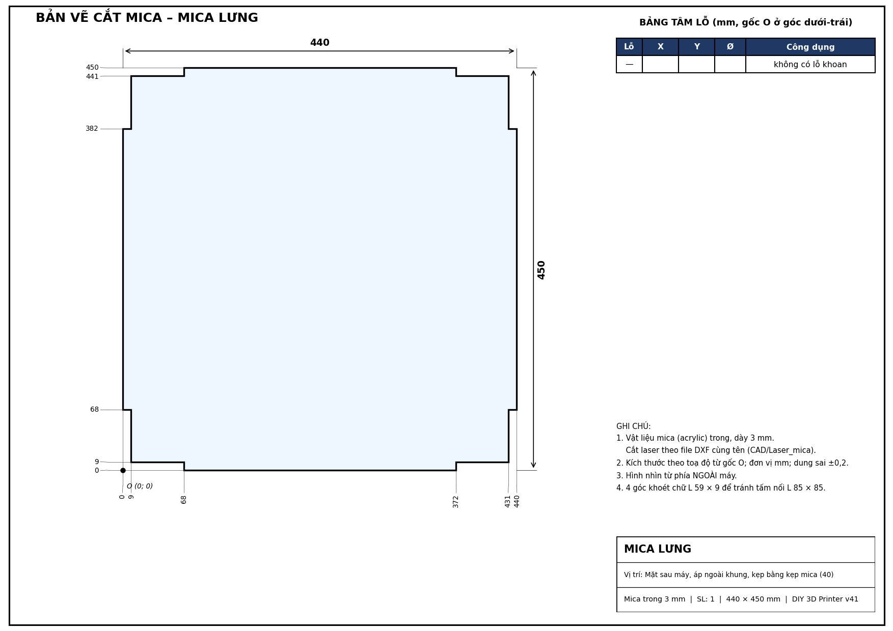
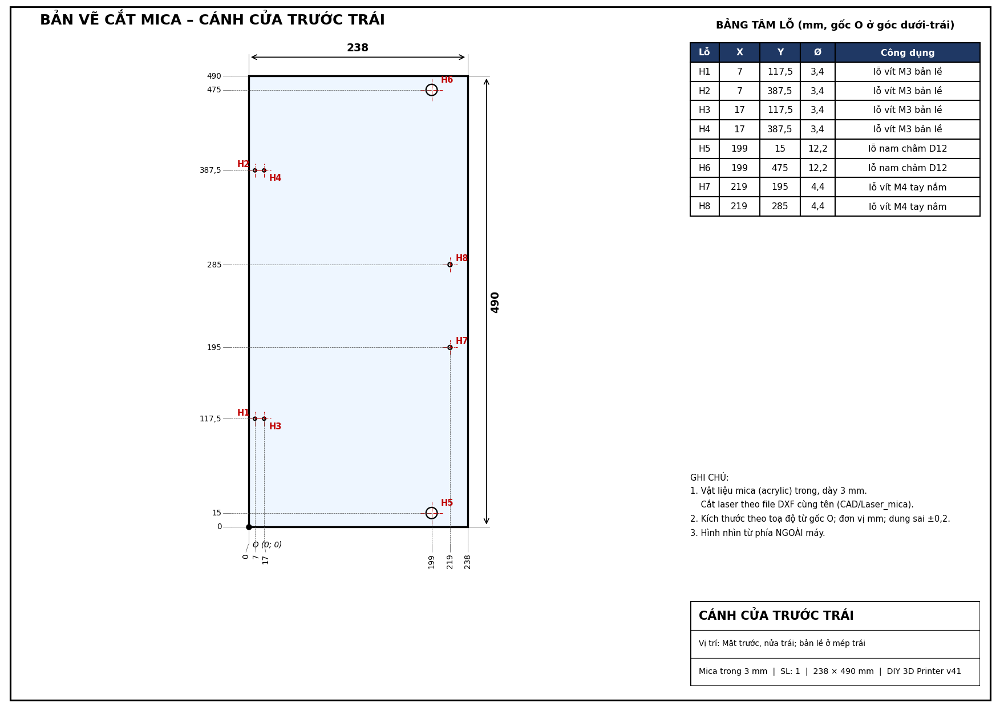
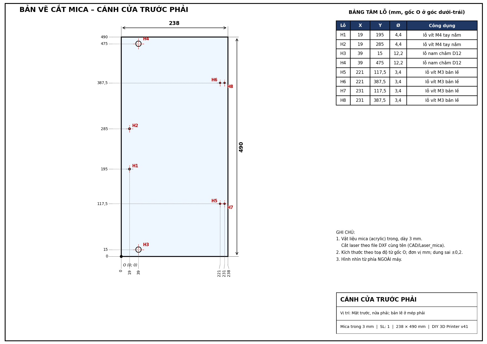
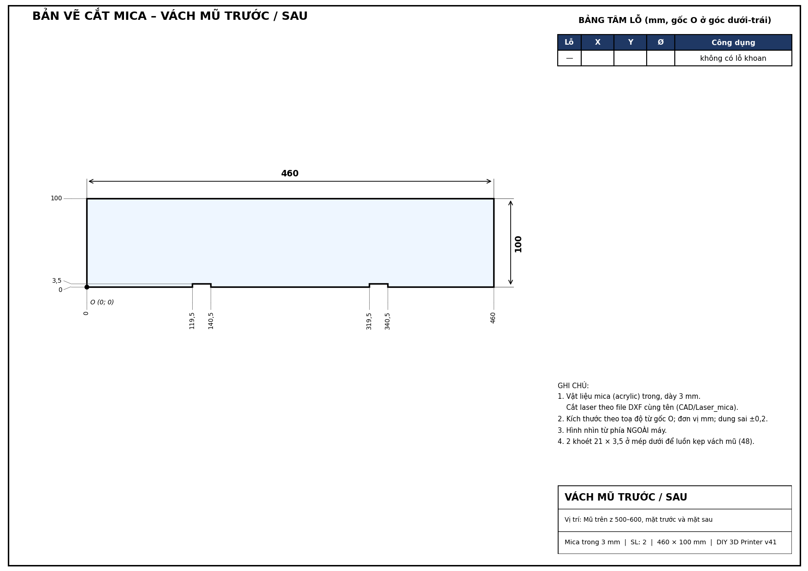
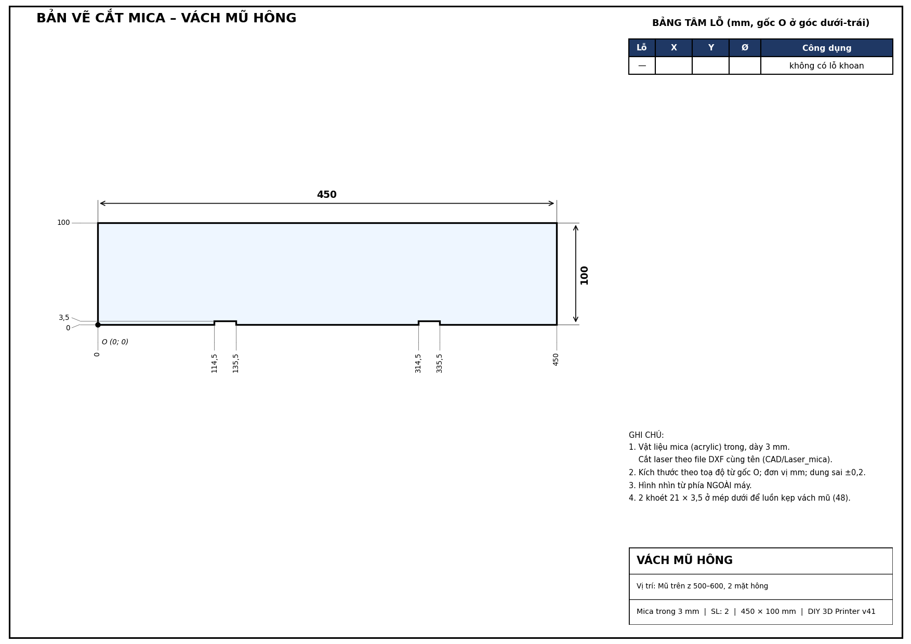
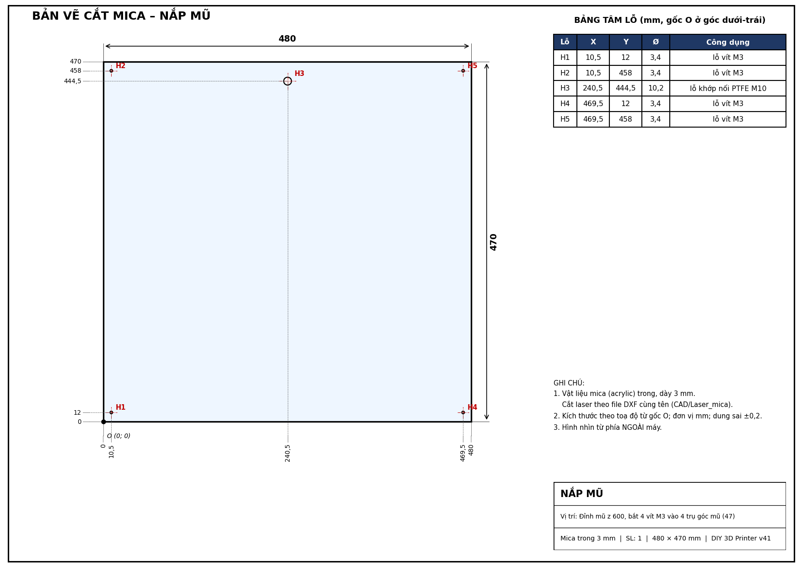

# BOM – danh sách vật tư

File đầy đủ: [`BOM_DIY_3D_Printer.xlsx`](BOM_DIY_3D_Printer.xlsx) (có bản vẽ mica và link mua hàng). Part nhựa in 3D không nằm trong BOM – xem thư mục [`STL`](../STL). Bản vẽ cắt mica gộp: [`CAD/Laser_mica/Ban_ve_cat_mica.pdf`](../CAD/Laser_mica/Ban_ve_cat_mica.pdf).

## 1. Khung nhôm

| STT | Tên | Kích thước / quy cách | Số lượng |
|---|---|---|---|
| 1 | Nhôm định hình 3030 (rãnh 8) | Dài 500 mm, cắt vuông 2 đầu | 4 |
| 2 | Nhôm định hình 3030 (rãnh 8) | Dài 420 mm | 4 |
| 3 | Nhôm định hình 3030 (rãnh 8) | Dài 410 mm | 6 |
| 4 | Nhôm định hình 2020 (rãnh 6) | Dài 415 mm | 2 |
| 5 | Nhôm định hình 2020 (rãnh 6) | Dài 225 mm, ta-rô M5 hai đầu | 3 |
| 6 | Nhôm định hình 2020 (rãnh 6) | Dài 407 mm | 1 |

## 2. Thanh trượt

| STT | Tên | Kích thước / quy cách | Số lượng |
|---|---|---|---|
| 1 | Ray trượt MGN12 | Dài 400 mm, 16 lỗ M3 bước 25, lỗ đầu cách đầu ray 12,5 | 2 |
| 2 | Ray trượt MGN12 | Dài 360 mm, 14 lỗ M3 bước 25, lỗ đầu cách đầu ray 17,5 | 1 |
| 3 | Con trượt MGN12H | Loại dài H, 4 lỗ M3 (20 × 20) | 3 |
| 4 | Vít me T8 – trục Z (liền trục motor Z ở mục 12, không mua riêng) | T8 (Ø8), 4 mối, bước ren 2 mm, hành trình 8 mm/vòng, dài 350 mm; đi với đai ốc đồng T8 | 2 |
| 5 | Đai ốc đồng T8 | Mặt bích Ø22, 4 lỗ Ø3,5 trên vòng Ø16, thân Ø10,2 | 2 |
| 6 | Trục trơn Ø12 | Thép C45 mạ crom, h6, dài 372 mm | 4 |
| 7 | Bạc đạn trượt LM12UU | Ø21 × 30, lỗ 12 | 8 |

## 3. Tấm mica

| STT | Tên | Kích thước / quy cách | Số lượng |
|---|---|---|---|
| 1 | Mica trong 3 mm – hông Vị trí: Mặt hông trái + phải, áp ngoài khung, kẹp bằng kẹp mica (40) | 430 × 450, 4 góc khoét chữ L tránh tấm L 85, 2 lỗ Ø7 Xem bản vẽ cắt có toạ độ tâm lỗ: sheet "Ban ve mica". | 2 |
|  |  |  |  |
| 2 | Mica trong 3 mm – lưng Vị trí: Mặt sau, áp ngoài khung | 440 × 450, 4 góc khoét chữ L Xem bản vẽ cắt có toạ độ tâm lỗ: sheet "Ban ve mica". | 1 |
|  |  |  |  |
| 3 | Mica trong 3 mm – cánh cửa Vị trí: Mặt trước, 2 cánh mở bằng bản lề in (41–44) | 238 × 490; 4 lỗ Ø3,4 (bản lề), 2 lỗ Ø4,4 (tay nắm), 2 lỗ Ø12,2 (nam châm) Xem bản vẽ cắt có toạ độ tâm lỗ: sheet "Ban ve mica". | 2 |
|  |   |  |  |
| 4 | Mica trong 3 mm – vách mũ trước/sau Vị trí: Mũ trên z 500–600, mặt trước + sau | 460 × 100, 2 khoét 21 × 3,5 mép dưới Xem bản vẽ cắt có toạ độ tâm lỗ: sheet "Ban ve mica". | 2 |
|  |  |  |  |
| 5 | Mica trong 3 mm – vách mũ hông Vị trí: Mũ trên z 500–600, 2 mặt hông | 450 × 100, 2 khoét 21 × 3,5 mép dưới Xem bản vẽ cắt có toạ độ tâm lỗ: sheet "Ban ve mica". | 2 |
|  |  |  |  |
| 6 | Mica trong 3 mm – nắp mũ Vị trí: Đỉnh mũ z 600, bắt 4 vít M3 vào trụ góc mũ (47) | 480 × 470, 4 lỗ Ø3,4, 1 lỗ Ø10,2 (khớp PTFE) Xem bản vẽ cắt có toạ độ tâm lỗ: sheet "Ban ve mica". | 1 |
|  |  |  |  |

## 4. Nam châm

| STT | Tên | Kích thước / quy cách | Số lượng |
|---|---|---|---|
| 1 | Nam châm tròn | D12 × 2 | 4 |
| 2 | Nam châm tròn lỗ vát M3 | D12 × 3, lỗ vát M3 | 4 |

## 5. Góc ke

| STT | Tên | Kích thước / quy cách | Số lượng |
|---|---|---|---|
| 1 | Ke chìm chữ L 3030 30 Series M6 | 35,5 × 30,3, rộng 14,2, gờ 7,5, dày 7,2; mỗi cạnh 1 lỗ ren M6 | 24 |
| 2 | Tấm nối chữ L 85 × 85 | Inox/thép, rộng 26, dày 4, 4 lỗ M6 (cách góc ngoài 43,5 và 73,5) | 12 |
| 3 | Ke góc nhôm đúc 3030 | 2 cạnh 30, dày 4, rộng 28, 1 lỗ M6 mỗi cạnh | 4 |

## 6. Ốc (bulông, đai ốc, long đền)

| STT | Tên | Kích thước / quy cách | Số lượng |
|---|---|---|---|
| 1 | Long đền M3 | Ø7 × 0,5, lỗ 3,2 | 4 |
| 2 | Bulông M5x10 | DIN 912, M5 × 10 mm | 10 |
| 3 | Bulông M5x14 | DIN 912, M5 × 14 mm | 4 |
| 4 | Bulông M5x16 | DIN 912, M5 × 16 mm | 22 |
| 5 | Bulông M5x35 | DIN 912, M5 × 35 mm (trục bản lề cửa) | 4 |
| 6 | Bulông M6x12 đầu tròn | Đầu tròn lục giác chìm ISO 7380, M6 × 12 mm, lục giác 4 mm | 174 |
| 7 | Bulông M6x12 đầu tròn (vào lỗ ren ke chìm) | Đầu tròn lục giác chìm ISO 7380, M6 × 12 mm, lục giác 4 mm; vặn thẳng vào lỗ ren ke chìm, KHÔNG T-nut | 6 |
| 8 | Bulông M6x10 đầu tròn (vào lỗ ren ke chìm) | Đầu tròn lục giác chìm ISO 7380, M6 × 10 mm, lục giác 4 mm; bắt từ dưới lên qua tai, vặn vào lỗ ren ke chìm, KHÔNG T-nut | 4 |
| 9 | Bulông M6x12 đầu trụ | DIN 912, M6 × 12 mm (đầu Ø10, lục giác 5 mm) | 4 |
| 10 | Đai ốc chữ T M6 (rãnh 8, 3030) | T-nut búa hoặc lò xo, M6, dài 11, rộng thân 15 | 178 |
| 11 | Đai ốc chữ T M5 (rãnh 6, 2020) | T-nut búa, M5, dài 10, rộng thân 10 | 30 |
| 12 | Đai ốc chữ T M3 (rãnh 8, 3030) | T-nut M3, dài 10 | 28 |
| 13 | Đai ốc chữ T M3 (rãnh 6, 2020) | T-nut M3, dài 10 | 14 |
| 14 | Đai ốc M3 | Lục giác 5,5, dày 2,4 | 18 |
| 15 | Đai ốc khóa M5 (có nhựa) | M5 nylon lock nut | 4 |
| 16 | Đai ốc cấy nhiệt M3 | Ø5 × 5 (ép nóng) | 12 |
| 17 | Long đền M5 | Ø10 × 1,5, lỗ 5,3 | 8 |

## 7. Vít

| STT | Tên | Kích thước / quy cách | Số lượng |
|---|---|---|---|
| 1 | Vít không đầu M6x8 (grub) | Lục giác chìm 3 mm, M6 × 8 | 38 |
| 2 | Vít cân bàn M3x80 | Đầu côn hoặc đầu tròn, M3 × 80 | 4 |
| 3 | Vít M3x35 | DIN 912, M3 × 35 mm | 4 |
| 4 | Vít M2.5x6 | DIN 912, M2.5 × 6 mm (bắt Raspberry Pi) | 4 |
| 5 | Vít M3x6 | DIN 912, M3 × 6 mm | 10 |
| 6 | Vít M3x8 | Lục giác chìm đầu trụ DIN 912, M3 × 8 mm, thép đen 12.9 | 106 |
| 7 | Vít M3x10 | DIN 912, M3 × 10 mm | 36 |
| 8 | Vít M3x12 | DIN 912, M3 × 12 mm | 26 |
| 9 | Vít M3x16 | DIN 912, M3 × 16 mm | 8 |
| 10 | Vít M3x20 | DIN 912, M3 × 20 mm | 4 |
| 11 | Vít M3x25 | DIN 912, M3 × 25 mm | 10 |
| 12 | Vít M3x30 | DIN 912, M3 × 30 mm | 10 |
| 13 | Vít M3x40 | DIN 912, M3 × 40 mm | 5 |
| 14 | Vít M4x6 đầu bằng | Đầu côn chìm DIN 7991, M4 × 6 mm (bắt đáy nguồn) | 4 |
| 15 | Vít M4x6 tự ren | Vít tự ren đầu tròn M4 × 6 mm | 8 |
| 16 | Vít M4x12 tự ren | Vít tự ren đầu tròn M4 × 12 mm | 4 |

## 8. Puly

| STT | Tên | Kích thước / quy cách | Số lượng |
|---|---|---|---|
| 1 | Puly GT2 20 răng – ở trục động cơ XY | Bản 6 mm, lỗ trục 5, 2 vít định vị M3 | 2 |
| 2 | Puly dẫn hướng GT2 20 răng – không ở động cơ (4 trên joiner + 4 ở giá puly góc) | Có răng, lỗ 3, rộng 8,5 (vừa hốc 8,9 của joiner BLV) | 8 |

## 9. Dây đai

| STT | Tên | Kích thước / quy cách | Số lượng |
|---|---|---|---|
| 1 | Dây curoa GT2 | Bản 6 mm, sợi thủy tinh | 2 |

## 10. Linh kiện điện tử ở đầu in

| STT | Tên | Kích thước / quy cách | Số lượng |
|---|---|---|---|
| 1 | Công tắc hành trình quang khe U (X, sau đầu in) | PCB 33 × 10,5, 2 lỗ M3 cách 19, khe 5 | 1 |
| 2 | [BLTouch](https://shopee.vn/Ender-3-N%C3%A2ng-c%E1%BA%A5p-BL-Touch-3D-C%E1%BA%A3m-bi%E1%BA%BFn-c%E1%BA%A3m-%E1%BB%A9ng-C%E1%BA%A3m-bi%E1%BA%BFn-c%C3%A2n-b%E1%BA%B1ng-gi%C6%B0%E1%BB%9Dng-t%E1%BB%B1-%C4%91%E1%BB%99ng-Gi%C3%A1-%C4%91%E1%BB%A1-%C4%91%E1%BA%A7u-d%C3%B2-c%E1%BA%A3m-bi%E1%BA%BFn-cho-Kp3S-Reprap-MK8-i3-Anet-A8-Tevo-M%C3%A1y-in-3D-i.1013045727.40402222174) | Chính hãng hoặc 3DTouch | 1 |
| 3 | [Cảm biến gia tốc ADXL345 (GY-291)](https://shopee.vn/C%E1%BA%A2M-BI%E1%BA%BEN-GIA-T%E1%BB%90C-G%C3%93C-ADXL345-GIA-T%E1%BB%90C-G%C3%93C-NGHI%C3%8ANG-i.1045034041.27807598816) | 20,4 × 16,1, 2 lỗ cách 15,6 | 1 |
| 4 | [Đầu phun E3D V6 1,75 mm](https://shopee.vn/B%E1%BB%99-d%E1%BB%A5ng-c%E1%BB%A5-%C4%91%C3%B9n-3D-V6-3D-In-J-Head-Hotend-cho-d%C3%A2y-t%C3%B3c-1-75Mm-3Mm-0-2-0-3-0-4-0-5Mm-V%C3%B2i-phun-12V-Bowden-%C4%90%C6%B0%E1%BB%9Dng-d%C3%A0i-i.1013045727.42926582643) | Kèm heater 24 V 40 W, thermistor, béc 0,4 | 1 |
| 5 | [Extruder BMG (dual gear)](https://shopee.vn/M%E1%BA%A1ch-C%C3%B4ng-Su%E1%BA%A5t-Cho-B%C3%A0n-Nhi%E1%BB%87t-MOSFET-25A-30A-cho-M%C3%A1y-In-3D-i.20067164.4189999026) | Bản thường (clone được) | 1 |
| 6 | Motor NEMA17 pancake | Thân 23 mm, trục Ø5 | 1 |
| 7 | Quạt ly tâm 5015 | 24 V | 1 |
| 8 | Quạt 4010 | 24 V | 1 |

## 11. Linh kiện điện tử ở khoang điện (dưới máy)

| STT | Tên | Kích thước / quy cách | Số lượng |
|---|---|---|---|
| 1 | Nguồn Mean Well HRP-600-24 | 24 V 26,7 A, 248 × 105 × 63,5, 4 lỗ ren M4 đáy (152,4 × 63,6) | 1 |
| 2 | Hạ áp TOBSUN EA50-5V | 24 V → 5 V, vỏ 63,6 × 53 × 20, 2 lỗ đế cách 56,5 | 1 |
| 3 | [Mạch MKS Eagle V1.0](https://shopee.vn/M%E1%BA%A1ch-%C4%91i%E1%BB%81u-khi%E1%BB%83n-MKS-Eagle-T%C3%ADch-H%E1%BB%A3p-5-Driver-TMC2209-THANH-L%C3%9D-NGH%E1%BB%88-B%C3%81N-i.1903120796.43483127008?extraParams=%7B%22display_model_id%22%3A376758656953%2C%22model_selection_logic%22%3A3%7D&image_ids=vn-11134201-81ztc-mvs99prf21oof5) | 110 × 84, lỗ 102 × 76 | 1 |
| 4 | Raspberry Pi 3B | 85 × 56, lỗ 58 × 49 + thẻ nhớ ≥ 16 GB | 1 |
| 5 | [MOSFET bàn nhiệt 30 A](https://shopee.vn/M%E1%BA%A1ch-C%C3%B4ng-Su%E1%BA%A5t-Cho-B%C3%A0n-Nhi%E1%BB%87t-MOSFET-25A-30A-cho-M%C3%A1y-In-3D-i.20067164.4189999026) | 70 × 45, lỗ 62,8 × 37,8 | 1 |
| 6 | Thanh DIN 35 | 35 × 7,5, dài 400 mm | 1 |
| 7 | Ổ cắm IEC C14 | Có hộc cầu chì + công tắc, khoét ~ 46 × 27 | 1 |
| 8 | Cầu chì ống 5 × 20 | T5A 250 V | 2 |
| 9 | Cáp USB ngắn | USB-A ↔ USB-B/USB-C theo cổng MKS | 1 |

## 12. Linh kiện điện tử khác

| STT | Tên | Kích thước / quy cách | Số lượng |
|---|---|---|---|
| 1 | Motor bước NEMA17 thân 40 mm (trục X/Y) | 1,8°, trục Ø5 có mặt phẳng, ≥ 0,45 N·m | 2 |
| 2 | Motor bước NEMA17 liền vít me T8 (trục Z) | Vít me T8 dài 350 mm liền trục (bước ren 8, 4 mối) | 2 |
| 3 | Công tắc hành trình quang khe U (Y, góc sau‑trái) | PCB 33 × 10,5, 2 lỗ M3 cách 19, khe 5 | 1 |
| 4 | [Cảm biến hết nhựa Creality](https://shopee.vn/C%E1%BA%A3m-Bi%E1%BA%BFn-B%C3%A1o-H%E1%BA%BFt-Nh%E1%BB%B1a-M%C3%A1y-In-3D-Filament-Break-Detection-Sensor-i.20067164.6968948344) | Thân 40 × 31,5 | 1 |
| 5 | Dây điện 2,5 mm² chịu nhiệt | Đỏ + đen | 3 |
| 6 | Dây điện 1,0 mm² | Đỏ + đen + dây AC có PE | 3 |
| 7 | Dây tín hiệu 4 lõi (motor) / 3 lõi | Kéo dài dây motor, công tắc, cảm biến | 8 |
| 8 | Bàn nhiệt nhôm 310 × 310 | Dày 3, 24 V, 4 lỗ M3 ở góc cách 305 × 305, kèm thermistor | 1 |

## 13. Phụ kiện khác (không thuộc các mục trên)

| STT | Tên | Kích thước / quy cách | Số lượng |
|---|---|---|---|
| 1 | Lò xo cân bàn | Lò xo nén xanh Ø8, cao nén 15 (theo ảnh) | 4 |
| 2 | Núm vặn cân bàn | 8 cánh Ø37, ren M3 | 4 |
| 3 | Cột đệm nhôm | Ø6 × 15, lỗ 3,2 | 4 |
| 4 | Dây rút | 3–4 mm, dài 150 | 50 |
| 5 | Tấm PEI | 310 × 310 × 0,8 (đen) | 1 |
| 6 | Băng mút / ron xốp 1,5 mm | Bản 10 mm | 6 |
| 7 | Ron xốp cửa 3–4 mm | Bản 10 mm | 3 |
| 8 | Ống PTFE | Ø4 × 2, dài 1 m | 1 |
| 9 | Khớp nối PTFE (pneumatic) | M10 × 1 cho ống 4 mm | 2 |
| 10 | Chân cao su | Ø20, dày 2–4, có keo | 4 |

## Ghi chú

- Quy tắc bulông: part nhựa bắt vào nhôm 3030 dùng M6 + T‑nut M6; vào nhôm 2020 dùng M5 + T‑nut M5; ray MGN dùng M3.
- 10 bulông M6 đầu tròn của giá motor XY và giá puly góc vặn thẳng vào lỗ ren ke chìm, không T‑nut (ở giá motor lắp M6x10 trước M6x12 ngang).
- Số lượng cột "Số lượng" ở dòng tiêu đề mục là tổng của mục. Nên mua dư 10–20 % vít M3 và T‑nut.
- Dây điện, dây rút, băng xốp là ước tính (không có trong mô hình).
